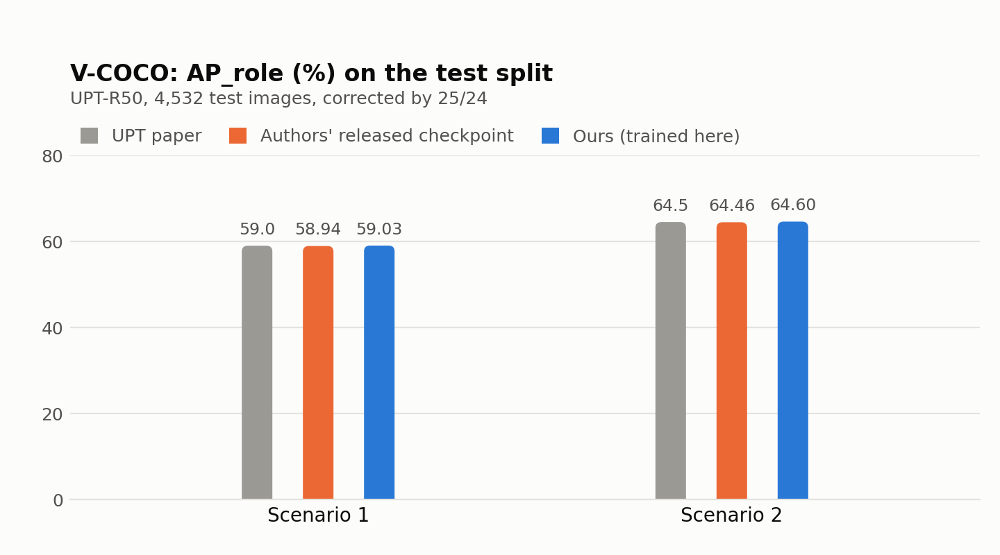

# UPT-R50 for human-object interaction detection

This project trains **UPT-R50**, the Unary-Pairwise Transformer with a ResNet-50 detector ([Zhang et al., CVPR 2022](https://arxiv.org/abs/2112.01838)), on **HICO-DET** and **V-COCO** in two independent runs on a single Windows GPU, and evaluates each trained model on both datasets.

## Results

Both trained models reproduce the published UPT-R50 numbers to within 0.5 points.

**HICO-DET**, Default mAP (%) on `test2015`:

| | Full | Rare | Non-rare |
|---|---:|---:|---:|
| UPT paper | 31.66 | 25.94 | 33.36 |
| Authors' released checkpoint | 31.72 | 26.09 | 33.41 |
| **Ours** | **31.66** | **26.44** | **33.22** |

**V-COCO**, AP_role (%) on the test split, corrected by 25/24:

| | Scenario 1 | Scenario 2 |
|---|---:|---:|
| UPT paper | 59.0 | 64.5 |
| Authors' released checkpoint | 58.94 | 64.46 |
| **Ours** | **59.03** | **64.60** |

**Cross-dataset**: each model scored on the other dataset by translating its predicted classes.

| Model | HICO-DET Full mAP | V-COCO AP_role S1 / S2 |
|---|---:|---:|
| Trained on HICO-DET | **31.66** | 44.35 / 48.30 |
| Trained on V-COCO | 7.03 | **59.03 / 64.60** |

On V-COCO, the HICO-DET model scores about 75% of what the V-COCO-trained model does. The V-COCO model reaches 7.03 mAP on HICO-DET because only 147 of HICO-DET's 600 interaction classes have a V-COCO counterpart; over those 147 classes its mAP is 28.71. [results.md](results.md) has the full tables, per-class analysis and verification.

## Setup

| Item | Value |
|---|---|
| Model | UPT-R50; DETR detector frozen, interaction head trained |
| Training | 20 epochs, batch 16 (8 passes of 2 images), AdamW lr 1e-4, weight decay 1e-4, lr ÷10 at epoch 10, gradient clip 0.1, seed 66 |
| HICO-DET run | 47,040 steps, 16 h 15 min, 37,633 training images |
| V-COCO run | 6,200 steps, 4,969 training images |
| Machine | Windows 11, NVIDIA GeForce RTX 5060 Laptop GPU (8 GB), 16 GB RAM |
| Software | Python 3.14.6, PyTorch 2.14.1+cu130, torchvision 0.29.1+cu130 |

Training and evaluation are single-process Windows adaptations of the upstream UPT code; see [PATCHES.md](PATCHES.md) for the changes.

## Documentation

| File | Contents |
|---|---|
| [results.md](results.md) | All results, figures, training runs, verification |
| [REPRODUCE.md](REPRODUCE.md) | Setup, training, evaluation and figure commands |
| [experiment-plan.md](experiment-plan.md) | Experiment protocol and configuration |
| [PATCHES.md](PATCHES.md) | Changes to the upstream UPT and V-COCO evaluator code |
| [data/manifest.md](data/manifest.md) | Dataset sizes and annotation checksums |

Datasets, model weights, training checkpoints, prediction caches and the upstream clones are not stored in this repository; [REPRODUCE.md](REPRODUCE.md) explains how to restore them.

## Upstream references

- UPT paper and code: <https://github.com/fredzzhang/upt>
- HICO-DET dataset: <https://umich-ywchao-hico.github.io/>
- V-COCO annotations and evaluator: <https://github.com/s-gupta/v-coco>
- COCO 2014 images and annotations: <https://cocodataset.org/#download>
