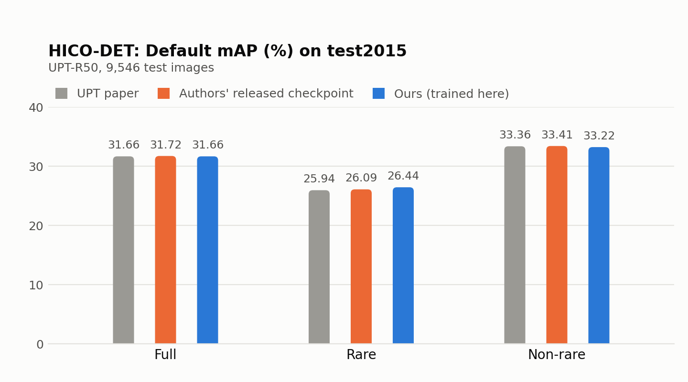
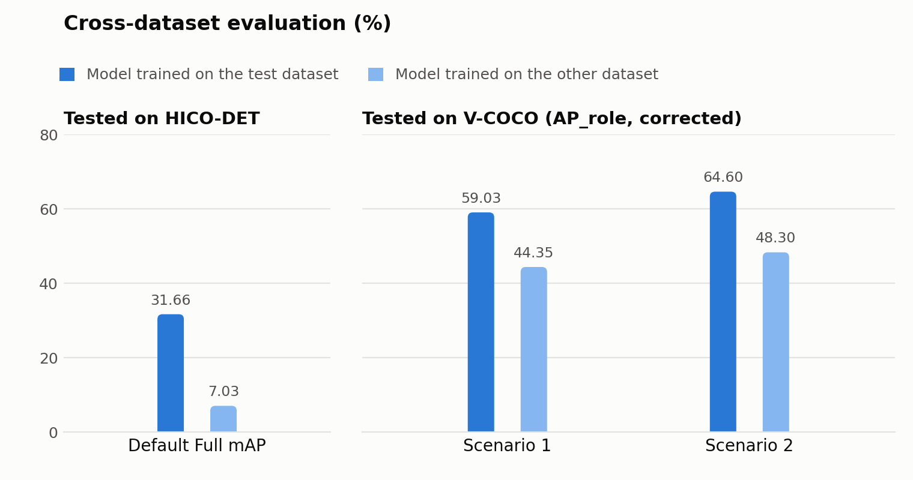

# UPT-R50 on HICO-DET and V-COCO

Reproduction of [UPT](https://arxiv.org/abs/2112.01838) (Unary-Pairwise Transformer, CVPR 2022) for human-object interaction detection. Two models trained on a single Windows laptop GPU (RTX 5060, 8 GB): one on HICO-DET, one on V-COCO. Each is tested on both datasets.

## Results

Same-dataset results match the paper.

| | HICO-DET mAP (full / rare / non-rare) | V-COCO AP_role (S1 / S2) |
|---|---|---|
| Paper | 31.66 / 25.94 / 33.36 | 59.0 / 64.5 |
| Authors' released weights, rescored here | 31.72 / 26.09 / 33.41 | 58.94 / 64.46 |
| **Ours** | **31.66 / 26.44 / 33.22** | **59.03 / 64.60** |

Cross-dataset (not in the paper):

| Trained on | Tested on HICO-DET (full mAP) | Tested on V-COCO (S1 / S2) |
|---|---:|---:|
| HICO-DET | 31.66 | 44.35 / 48.30 |
| V-COCO | 7.03 | 59.03 / 64.60 |





How to read these:

- **V-COCO scores are multiplied by 25/24.** The scorer averages 25 roles including `point instr`, which is always 0; the UPT authors exclude it this way ([discussion](https://github.com/fredzzhang/upt/discussions/14)). `metrics.json` has both raw and corrected values.
- **Cross-dataset means translating class names.** HICO-DET has 117 verbs and V-COCO has 24 actions. A prediction is kept if the other dataset has the same verb or one of the 14 pairs hand-picked in `cross_dataset.py` (the loosest: `look`/`watch`, `hit`/`swing`). Everything else is dropped.
- **Why V-COCO to HICO-DET is only 7.03.** Only 147 of the 600 HICO-DET interactions have a V-COCO counterpart; the other 453 score zero. Over those 147 the mAP is 28.71.
- **HICO-DET to V-COCO** covers 23 of 24 actions (`eat instr` has no match).

Every number comes from a `metrics.json` in `outputs/trained-evaluation/`; the folder names say what was tested (`hico-on-vcoco` is the HICO-DET model on V-COCO, `official-*` are the authors' weights).

## Trained weights

| Model | Download | Size | SHA-256 |
|---|---|---:|---|
| HICO-DET | [Google Drive](https://drive.google.com/file/d/1pwI9_FOfNQgv37orY0xMUfrBLVxNSER2/view?usp=sharing) | 310 MB | `2de8eadc92054f220e5423c60b274b118fe05114ae6452edb0539f702f5d63ec` |
| V-COCO | [Google Drive](https://drive.google.com/file/d/1y8uKdZbmsW6xrrU7W10bWSvgJuGBwQbV/view?usp=sharing) | 309 MB | `61dbd4a0e7c47c629b1ded5f913c6acb7374b4d09eb27a95eedb3bc570acdcda` |

Check a download with `Get-FileHash <file>`. To evaluate one, pass it as `--checkpoint` in the commands under Evaluate (the file name doesn't matter). The files contain the detector weights too.

## Differences from the paper's setup

- One GPU instead of eight. A step of 16 images is built from 8 forward passes of 2 images, with gradients divided by the total positive pairs, which matches the authors' multi-GPU update.
- Everything else follows their recipe: frozen DETR detector, interaction head only, 20 epochs, AdamW lr 1e-4, weight decay 1e-4, lr ÷10 at epoch 10, clip 0.1, seed 66.
- Training took 16 h 15 min for HICO-DET (47,040 steps) and about 4 h for V-COCO (6,200 steps).

## Setup

Python 3.14 on Windows with an NVIDIA GPU.

```powershell
python -m venv .venv
.\.venv\Scripts\Activate.ps1
pip install -r requirements.txt
```

Clone the two upstream repos at the pinned commits and apply the patches:

```powershell
git clone --recurse-submodules https://github.com/fredzzhang/upt.git .\repos\upt
git -C .\repos\upt checkout 192743045e4c5f6827299fdc15809f5b97ac1b8e
git -C .\repos\upt submodule update --init --recursive
git -C .\repos\upt apply ..\..\patches\upt-single-gpu-loss.patch

git clone https://github.com/s-gupta/v-coco.git .\repos\v-coco
git -C .\repos\v-coco checkout 489cc4db74f2f10ab4b134f67da3874afbf245ab
git -C .\repos\v-coco apply ..\..\patches\vcoco-evaluator-python3.patch
```

The patches are the edits this project needs in those repos: `upt-single-gpu-loss.patch` keeps the loss finite when a batch has no positive pairs and exposes the positive count; `vcoco-evaluator-python3.patch` ports the Python 2 V-COCO scorer to Python 3 and NumPy 2. Apply each once.

Data and weights (not in git):

- `data/hico_20160224_det/images/{train2015,test2015}`: [HICO-DET](https://umich-ywchao-hico.github.io/)
- `data/mscoco2014/{train2014,val2014,annotations}`: [COCO 2014](https://cocodataset.org/#download)
- `data/instances_*.json`: copy the six files from `repos/upt/hicodet/` and `repos/upt/vcoco/`
- `checkpoints/`: the DETR-R50 weights `detr-r50-hicodet.pth` and `detr-r50-vcoco.pth`, and optionally the released `upt-r50-hicodet.pt` and `upt-r50-vcoco.pt`, from the [UPT model zoo](https://github.com/fredzzhang/upt)

## Train

```powershell
.\train.ps1 hicodet
.\train.ps1 vcoco
```

Run one at a time (8 GB is enough for one). Checkpoints are saved every 250 steps and re-running the same command resumes. The final model is `outputs\training\<dataset>\checkpoint_final.pt`.

## Evaluate

```powershell
python .\evaluate_upt_hicodet_windows.py --checkpoint .\outputs\training\hicodet\checkpoint_final.pt --output-dir .\outputs\trained-evaluation\hico-on-hico
python .\evaluate_upt_hicodet_windows.py --checkpoint .\outputs\training\vcoco\checkpoint_final.pt --trained-on vcoco --output-dir .\outputs\trained-evaluation\vcoco-on-hico

python .\cache_upt_vcoco_windows.py --checkpoint .\outputs\training\vcoco\checkpoint_final.pt --output-dir .\outputs\trained-evaluation\vcoco-on-vcoco
python .\evaluate_upt_vcoco_cache.py --cache .\outputs\trained-evaluation\vcoco-on-vcoco\cache.pkl --output-dir .\outputs\trained-evaluation\vcoco-on-vcoco

python .\cache_upt_vcoco_windows.py --checkpoint .\outputs\training\hicodet\checkpoint_final.pt --trained-on hicodet --output-dir .\outputs\trained-evaluation\hico-on-vcoco
python .\evaluate_upt_vcoco_cache.py --cache .\outputs\trained-evaluation\hico-on-vcoco\cache.pkl --output-dir .\outputs\trained-evaluation\hico-on-vcoco
```

HICO-DET evaluation takes about 16 minutes, V-COCO about 20. Leave out `--checkpoint` and `--output-dir` to score the authors' released weights instead. `python .\make_figures.py` redraws `figures/` from the metrics files.

## Code

| File | Purpose |
|---|---|
| `train.ps1`, `train_upt_windows.py` | Launcher and single-GPU trainer |
| `evaluate_upt_hicodet_windows.py` | HICO-DET evaluation |
| `cache_upt_vcoco_windows.py`, `evaluate_upt_vcoco_cache.py` | V-COCO predictions, then scoring |
| `cross_dataset.py` | Class translation for cross-dataset tests |
| `common.py` | Code shared by the above |
| `make_figures.py` | Draws the figures |
| `patches/` | The two upstream patches |
