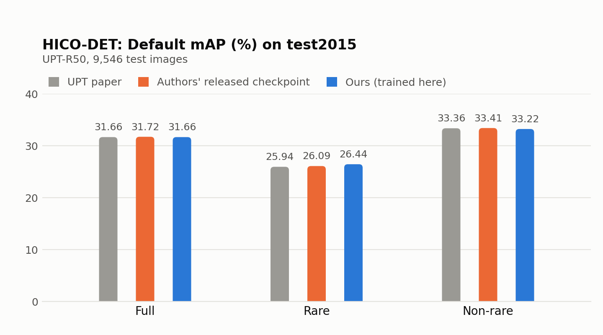
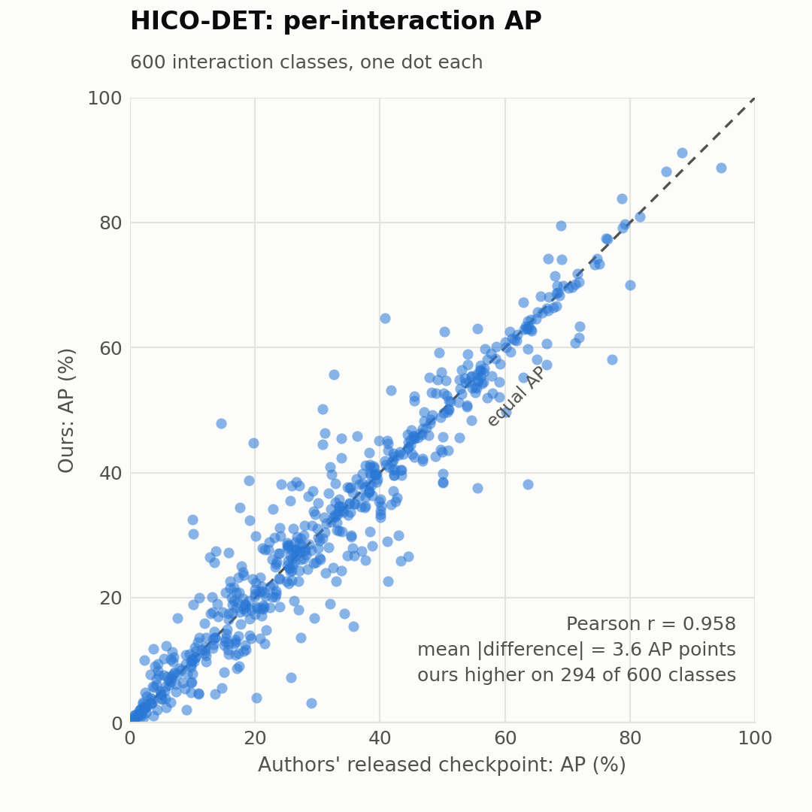
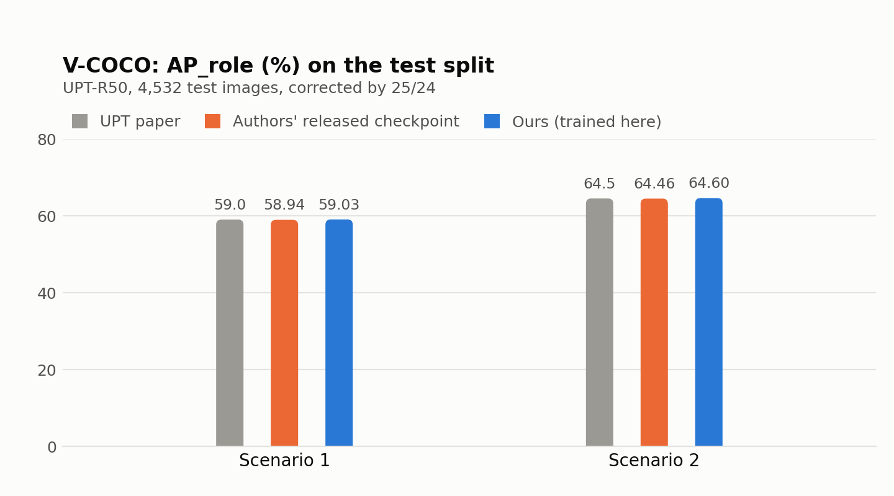
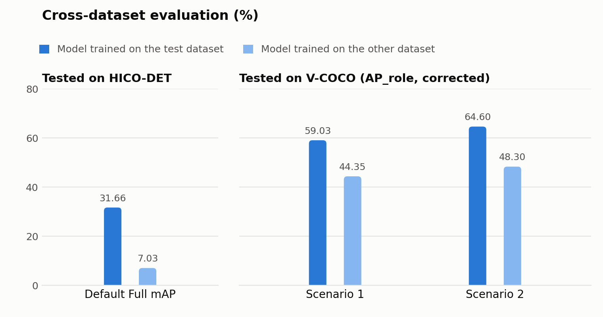
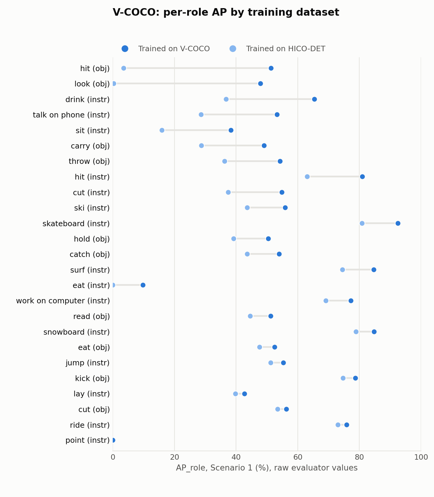

# Results

UPT-R50 trained on HICO-DET and on V-COCO, evaluated on each dataset's test split. Every number comes from a `metrics.json` file in `outputs/trained-evaluation/` (index in section 6). All evaluations ran on an NVIDIA GeForce RTX 5060 Laptop GPU with Python 3.14.6 and PyTorch 2.14.1+cu130. The test splits contain 9,546 images (HICO-DET `test2015`) and 4,532 images (V-COCO test).

**Summary**

- **HICO-DET:** Full 31.66, Rare 26.44, Non-rare 33.22 mAP. Full mAP equals the paper's 31.66.
- **V-COCO:** AP_role 59.03 (Scenario 1) and 64.60 (Scenario 2), corrected. The paper reports 59.0 and 64.5.
- **Cross-dataset:** the HICO-DET model scores 44.35 / 48.30 on V-COCO; the V-COCO model scores 7.03 mAP on HICO-DET, limited by class coverage.

## 1. HICO-DET

Default protocol, `test2015`. Rare classes are the 138 of 600 interactions with fewer than 10 training instances; the other 462 are non-rare.

| mAP (%) | UPT paper | Authors' released checkpoint | **Ours** | Ours - paper | Ours - released |
|---|---:|---:|---:|---:|---:|
| Full | 31.66 | 31.72 | **31.66** | 0.00 | -0.06 |
| Rare | 25.94 | 26.09 | **26.44** | +0.50 | +0.35 |
| Non-rare | 33.36 | 33.41 | **33.22** | -0.14 | -0.19 |

Our model is within 0.5 mAP of the paper on all three metrics and within 0.35 of the authors' released checkpoint. It is slightly better on rare interactions and slightly lower on non-rare ones.

The per-class view shows the same agreement. Across the 600 interaction classes the AP of our model and of the released checkpoint have a Pearson correlation of 0.958, with a mean absolute difference of 3.6 AP points per class. Ours is higher on 294 classes and lower on 306, so there is no systematic gap; individual classes vary because the two models were trained separately.

## 2. V-COCO

AP_role on the V-COCO test split at IoU 0.5. The evaluator averages over 25 role classes, including `point instr`, which scores 0.00 for every model. The UPT authors exclude it by multiplying the evaluator's mean by 25/24; the corrected values are the ones to compare with the paper.

| AP_role (%) | Raw S1 | **Corrected S1** | Raw S2 | **Corrected S2** |
|---|---:|---:|---:|---:|
| UPT paper | | 59.0 | | 64.5 |
| Authors' released checkpoint | 56.58 | 58.94 | 61.88 | 64.46 |
| **Ours** | 56.67 | **59.03** | 62.02 | **64.60** |

Ours is +0.03 (S1) and +0.10 (S2) above the paper, and about 0.1 above the authors' released checkpoint on both scenarios.

## 3. Training runs

Both models start from the dataset-specific DETR-R50 weights, keep the detector frozen, and train the UPT interaction head.

| | HICO-DET model | V-COCO model |
|---|---|---|
| Initialization | `detr-r50-hicodet.pth` | `detr-r50-vcoco.pth` |
| Training images | 37,633 | 4,969 |
| Epochs / optimizer steps | 20 / 47,040 (2,352 per epoch) | 20 / 6,200 (310 per epoch) |
| Final checkpoint SHA-256 | `2de8eadc92054f220e5423c60b274b118fe05114ae6452edb0539f702f5d63ec` | `61dbd4a0e7c47c629b1ded5f913c6acb7374b4d09eb27a95eedb3bc570acdcda` |

Shared settings: batch 16 (8 passes of 2 images, gradients accumulated on one GPU), AdamW with learning rate 1e-4 and weight decay 1e-4, learning rate ÷10 at epoch 10, gradient clipping 0.1, seed 66. The HICO-DET run took 16 h 15 min (about 1.24 s per step) and ended with a running-average training loss of 0.983.

## 4. Cross-dataset evaluation

HICO-DET has 117 verbs (600 verb-object interactions) and V-COCO has 24 actions, so a model trained on one cannot be scored on the other directly. Its predicted classes are translated: a class is kept when the other dataset has a counterpart (the same verb name, or one of the 14 hand-checked pairs in `cross_dataset.py`), and the prediction is also required to be valid for the detected object. Everything else is dropped. Target classes with no counterpart score zero.

| Model | HICO-DET Full mAP | Rare | Non-rare | V-COCO AP_role S1 / S2 (corrected) |
|---|---:|---:|---:|---:|
| Trained on HICO-DET (ours) | **31.66** | 26.44 | 33.22 | 44.35 / 48.30 |
| Trained on V-COCO (ours) | 7.03 | 1.57 | 8.67 | **59.03 / 64.60** |
| Authors' released HICO-DET checkpoint | 31.72 | 26.09 | 33.41 | 44.35 / 48.30 |
| Authors' released V-COCO checkpoint | | | | 58.94 / 64.46 |

How coverage shapes these numbers:

- **V-COCO model on HICO-DET.** Only 147 of the 600 interactions have a V-COCO counterpart. All 147 have non-zero AP and the other 453 score zero by construction. Over the 147 reachable classes the mAP is **28.71**, which is a different class mix from the paper's 31.66 and not a like-for-like comparison.
- **HICO-DET model on V-COCO.** 23 of the 24 actions have a counterpart. `eat instr` (fork, knife, spoon) has none and scores 0.00 (Scenario 1) and 0.13 (Scenario 2). `point instr` scores 0.00 for every model.
- **Judgement calls.** The loosest pairings are `look obj` / `watch` and `hit instr` / `swing`.

Per-role AP shows where the HICO-DET model loses ground. Six roles lose under 5 AP points: `ride instr`, `cut obj`, `lay instr`, `kick obj`, `jump instr` and `eat obj`. The drop is largest for `look obj` (0.26 against 47.88) and `hit obj` (3.50 against 51.29), and for `eat instr`, which has no counterpart (0.00 against 9.77). `drink instr`, `talk on phone instr` and `sit instr` are 22 to 29 points lower.

Per-role AP (%), Scenario 1, raw evaluator values

| Role | Trained on V-COCO | Trained on HICO-DET | Difference |
|---|---:|---:|---:|
| point instr | 0.00 | 0.00 | +0.00 |
| ride instr | 75.84 | 73.04 | -2.80 |
| cut obj | 56.27 | 53.42 | -2.85 |
| lay instr | 42.69 | 39.79 | -2.90 |
| kick obj | 78.65 | 74.69 | -3.96 |
| jump instr | 55.29 | 51.18 | -4.11 |
| eat obj | 52.52 | 47.62 | -4.90 |
| snowboard instr | 84.76 | 78.89 | -5.87 |
| read obj | 51.21 | 44.52 | -6.69 |
| work on computer instr | 77.25 | 69.10 | -8.15 |
| eat instr | 9.77 | 0.00 | -9.77 |
| surf instr | 84.68 | 74.53 | -10.15 |
| catch obj | 53.95 | 43.58 | -10.37 |
| hold obj | 50.45 | 39.18 | -11.27 |
| skateboard instr | 92.46 | 80.83 | -11.63 |
| ski instr | 55.90 | 43.63 | -12.27 |
| cut instr | 54.81 | 37.43 | -17.38 |
| hit instr | 80.93 | 63.05 | -17.88 |
| throw obj | 54.26 | 36.23 | -18.03 |
| carry obj | 49.08 | 28.69 | -20.39 |
| sit instr | 38.28 | 15.94 | -22.34 |
| talk on phone instr | 53.25 | 28.62 | -24.63 |
| drink instr | 65.39 | 36.78 | -28.61 |
| look obj | 47.88 | 0.26 | -47.62 |
| hit obj | 51.29 | 3.50 | -47.79 |

## 5. Verification

The reported numbers were cross-checked against the underlying files:

- **HICO-DET aggregates.** For every HICO-DET evaluation, Full, Rare and Non-rare mAP were recomputed from the stored AP of all 600 interactions. The rare split was derived independently from the training annotations (interactions with fewer than 10 training instances: 138 rare, 462 non-rare). All three values matched the stored ones.
- **Checkpoints.** The SHA-256 of both trained checkpoints, recomputed from the files, equals the hash recorded in the matching `metrics.json` and `cache-manifest.json`.
- **Datasets.** The six annotation files match the checksums in `data/manifest.md`, and the image counts per partition match its table.
- **V-COCO scoring.** All four V-COCO prediction caches were scored again with the final scorer. Scenario scores were identical to the stored values, and each corrected score equals the raw score times 25/24.
- **Distinct runs.** Each V-COCO `metrics.json` records the hash of its own prediction cache, and the caches of different checkpoints have different hashes.

**Same averages, different models.** The authors' released HICO-DET checkpoint and ours both score 42.58 / 46.37 (raw) on V-COCO. That is a coincidence of the averages: the two prediction caches differ, and the per-role AP differs in 23 of the 25 roles in each scenario, by up to 2.7 AP points (for example `kick obj` 77.15 against 74.69 and `talk on phone instr` 26.80 against 28.62 in Scenario 1), with the differences cancelling in the mean.

## 6. Evaluation runs

| Folder in `outputs/trained-evaluation/` | Checkpoint | Tested on |
|---|---|---|
| `hico-on-hico` | ours, trained on HICO-DET (`2de8eadc`) | HICO-DET |
| `hico-on-vcoco` | ours, trained on HICO-DET (`2de8eadc`) | V-COCO |
| `vcoco-on-vcoco` | ours, trained on V-COCO (`61dbd4a0`) | V-COCO |
| `vcoco-on-hico` | ours, trained on V-COCO (`61dbd4a0`) | HICO-DET |
| `official-hico` | authors' released HICO-DET (`12f7f84c`) | HICO-DET |
| `official-hico-on-vcoco` | authors' released HICO-DET (`12f7f84c`) | V-COCO |
| `official-vcoco` | authors' released V-COCO (`fe26808d`) | V-COCO |

Figures are generated from these files by `make_figures.py`.

## References

1. F. Z. Zhang, D. Campbell, and S. Gould, "Efficient Two-Stage Detection of Human-Object Interactions with a Novel Unary-Pairwise Transformer," CVPR 2022. Paper: <https://arxiv.org/abs/2112.01838>. Official implementation and model zoo: <https://github.com/fredzzhang/upt>.
2. UPT authors, V-COCO evaluation instructions and 25/24 correction: <https://github.com/fredzzhang/upt/discussions/14>.
3. S. Gupta and J. Malik, "Visual Semantic Role Labeling," 2015. V-COCO code and data: <https://github.com/s-gupta/v-coco>.
4. HICO-DET dataset page: <https://umich-ywchao-hico.github.io/>. Dataset paper: <https://arxiv.org/abs/1702.05448>.
5. COCO 2014 images and annotations: <https://cocodataset.org/#download>.
